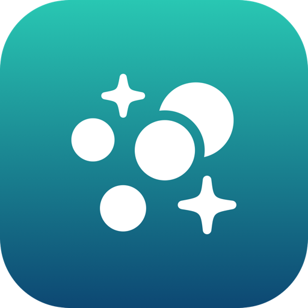
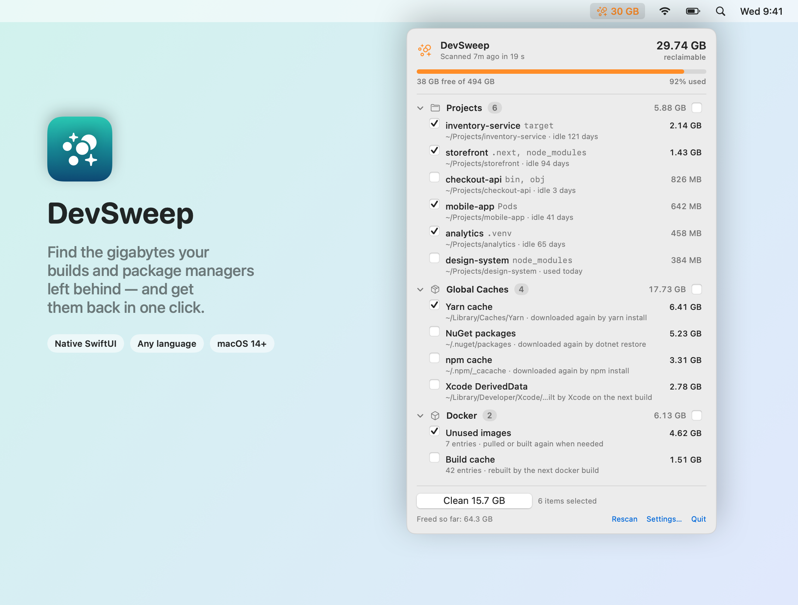
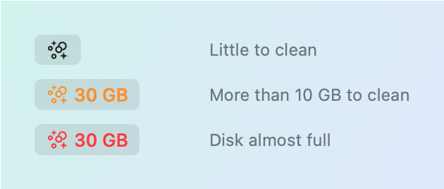
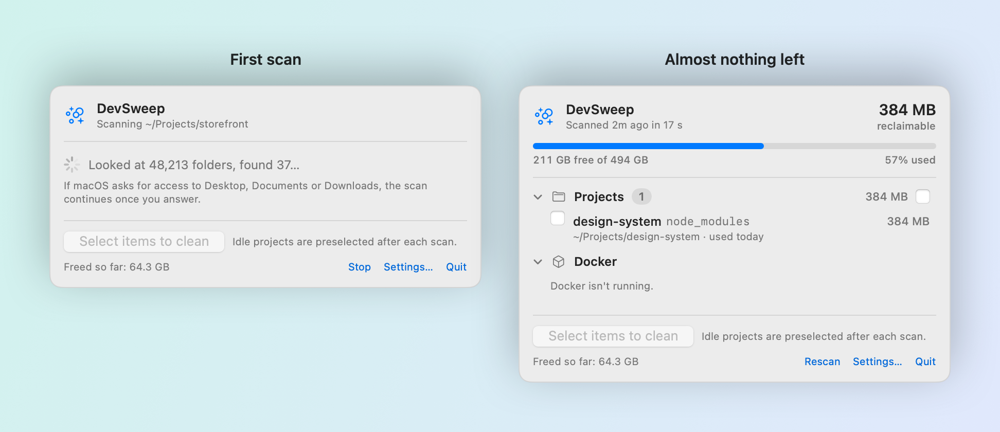
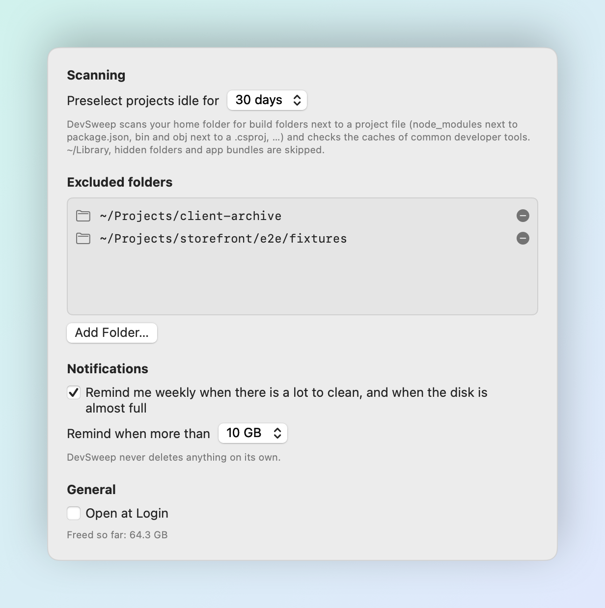

<div align="center">



# DevSweep

**Find the gigabytes your builds and package managers left behind — and get them back in one click, from the macOS menu bar.**

[](https://github.com/recepysl/dev-sweep/actions/workflows/ci.yml)
[](https://github.com/recepysl/dev-sweep/releases/latest)


[](LICENSE)

[**Download**](https://github.com/recepysl/dev-sweep/releases/latest) ·
[Features](#-features) ·
[What it cleans](#-what-it-cleans) ·
[Safety](#-safety) ·
[Build from source](#-build-from-source) ·
[Architecture](docs/ARCHITECTURE.md)

<br>

<picture>
  <source media="(prefers-color-scheme: dark)" srcset="docs/images/hero-dark.png">
  
</picture>

</div>

## Why

Every project you ever cloned left something behind: a `node_modules` folder, `bin` and `obj`, a Rust `target`, a Python `.venv`, `Pods`. Every package manager keeps its own download cache: npm, Yarn, NuGet, Gradle, Maven, pip, Homebrew. Xcode keeps DerivedData, Docker keeps old images and build cache. Together that is easily **30–150 GB** on a developer machine — and nobody wants to hunt it down by hand or type `rm -rf` into the wrong folder.

**DevSweep** finds all of it, shows how big each piece is and how long ago you touched the project, and deletes what you pick. Everything it offers is *regenerable*: it comes back with the next `npm install`, `dotnet restore` or build.

## ✨ Features

|   |   |
| --- | --- |
| 📁 **Projects** | Scans your home folder for build and dependency folders that sit next to their project file — `node_modules` next to `package.json`, `bin`/`obj` next to a `.csproj`, `target` next to `Cargo.toml` or `pom.xml`, and more. Grouped per project, with the days since you last changed a file in it. |
| 📦 **Global caches** | npm, Yarn, pnpm, Bun, NuGet, Gradle, Maven, pip, uv, Poetry, Go, Cargo, CocoaPods, SwiftPM, Composer, Deno, Homebrew, Playwright, Xcode DerivedData, DeviceSupport and simulator caches. |
| 🐳 **Docker** | Unused images, stopped containers and build cache, through the `docker` CLI (Docker Desktop, OrbStack, Colima, Rancher Desktop). Volumes are never touched. |
| ☑️ **Smart preselection** | After each scan, projects you haven't touched for 30 days (configurable) are ticked; caches and Docker are left for you to decide. |
| 🧹 **One click** | *Clean 15.7 GB* asks once, listing what goes, then deletes it. A running total shows how much you have freed so far. |
| 💽 **Disk at a glance** | Free space bar in the dropdown; the menu bar shows the reclaimable amount and turns orange above 10 GB or when less than 10 % of the disk is free, red below 5 %. |
| 🔔 **Gentle reminders** | At most one notification a week when there is a lot to clean, and one a day when the disk is almost full. DevSweep never deletes anything on its own. |
| 🙈 **Exclusions** | Right-click any project or cache → *Exclude from Scans*, or manage the list in Settings. |
| ⚡ **Fast** | A parallel scanner built on `getattrlistbulk`: a home folder with ~100 000 source folders and 500+ build folders is scanned in about 20 seconds. |
| 🪶 **Tiny & native** | Swift and SwiftUI, zero dependencies, no Dock icon, no Electron, no network access. |

## 🎨 States

<picture>
  <source media="(prefers-color-scheme: dark)" srcset="docs/images/menubar-dark.png">
  
</picture>

<picture>
  <source media="(prefers-color-scheme: dark)" srcset="docs/images/states-dark.png">
  
</picture>

> Every screenshot in this README is rendered by the app itself from demo data — run `make screenshots` to regenerate them.

## 🧾 What it cleans

**Project folders** — only when the project file is right next to them:

| Folder | Next to | Comes back with |
| --- | --- | --- |
| `node_modules` | `package.json` | `npm install` / `yarn` / `pnpm install` |
| `.next`, `.nuxt`, `.svelte-kit`, `.turbo`, `.parcel-cache`, `.angular` | `package.json` | the next build |
| `bin`, `obj` | `*.csproj`, `*.fsproj`, `*.vbproj` | `dotnet restore && dotnet build` |
| `.build` | `Package.swift` | `swift build` |
| `target` | `Cargo.toml` / `pom.xml` | `cargo build` / `mvn package` |
| `build`, `.gradle` | `build.gradle(.kts)`, `settings.gradle(.kts)` | `./gradlew build` |
| `.dart_tool`, `build` | `pubspec.yaml` | `flutter pub get` |
| `Pods` | `Podfile` | `pod install` |
| `.venv`, `venv` | `pyproject.toml`, `requirements.txt`, `setup.py`, `Pipfile` | recreate the environment |
| `.tox` | `tox.ini` | `tox` |
| `.terraform` | `*.tf` | `terraform init` |

**Global caches** — fixed locations under your home folder, see [`Rules.swift`](Sources/SweepKit/Rules.swift) for the full list.

**Never touched:** anything without its project file next to it, `dist`/`out` (sometimes committed), Xcode Archives, Docker volumes, `~/Library` outside the listed caches, hidden folders such as `~/.vscode` or `~/.nvm`, app bundles, `~/Pictures`, `~/Music` and `~/Movies`.

## 🛡 Safety

- **Rules, not guesses.** A folder is offered only when its name *and* its project file match a rule.
- **Checked again before deleting.** Right before removal each path is re-validated: still inside your home folder, canonical (no `..`), a real folder and not a symbolic link, not excluded, and its project file is still there. Anything that fails is skipped and reported.
- **No symlinks followed, no other volumes.** The scanner never follows symbolic links or crosses into mounted volumes.
- **Honest sizes.** Hard-linked files (pnpm, some caches) aren't counted, because deleting one link doesn't free the space.
- **Deleted, not trashed.** Moving 20 GB to the Trash frees nothing until you empty it, so DevSweep deletes directly — after one confirmation that lists everything.

## 📦 Install

**Requirements:** macOS 14 Sonoma or later.

**One-line install (recommended)** — downloads the latest release into `/Applications` and launches it:

```bash
curl -fsSL https://raw.githubusercontent.com/recepysl/dev-sweep/main/scripts/install.sh | bash
```

**Or install manually:**

1. Download the latest **`DevSweep-x.y.z.dmg`** from [Releases](https://github.com/recepysl/dev-sweep/releases/latest).
2. Open it and drag **DevSweep** onto **Applications**.
3. Launch it — an icon appears in your menu bar and the first scan starts.

> [!IMPORTANT]
> Builds are **ad-hoc signed and not notarized**, so a copy downloaded with a browser is blocked on first launch with *“Apple could not verify ‘DevSweep.app’…”*. Click **Done**, then open **System Settings → Privacy & Security**, scroll down and click **Open Anyway**. Or clear the flag in Terminal:
> ```bash
> xattr -dr com.apple.quarantine /Applications/DevSweep.app
> ```
> The one-line installer above doesn't hit this, because `curl` doesn't mark downloads as quarantined.

On the first scan macOS asks once whether DevSweep may access your **Desktop**, **Documents** and **Downloads** folders. Allow it if you keep projects there; otherwise those folders are simply skipped.

<picture>
  <source media="(prefers-color-scheme: dark)" srcset="docs/images/settings-dark.png">
  
</picture>

To remove it later: `make uninstall` (or run [`scripts/uninstall.sh`](scripts/uninstall.sh)).

## 🛠 Build from source

```bash
git clone https://github.com/recepysl/dev-sweep.git
cd dev-sweep
make install        # build DevSweep.app, copy it to /Applications and launch it
```

| Command | What it does |
| --- | --- |
| `make app` | Build `DevSweep.app` in the repo (release build, ad-hoc signed) |
| `make run` | Build and launch it from the repo |
| `make dmg` | Build a drag-to-Applications disk image in `dist/` |
| `make install` / `make uninstall` | Install to or remove from `/Applications` |
| `make once` | Dry run: scan and print what could be cleaned, delete nothing |
| `make selftest` | Rules, scanner and cleaner assertions against a temporary fixture — no Xcode needed |
| `make test` | The same assertions through XCTest (needs Xcode) |
| `make screenshots` | Re-render the README images from demo data |
| `make icon` | Regenerate `Resources/AppIcon.icns` |

The binary also understands a few flags:

| Flag | Purpose |
| --- | --- |
| `--once [--json] [--home <path>]` | Scan and print a report (or JSON) without deleting anything |
| `--selftest` | Run the built-in assertions; exit code `1` on failure |
| `--render-screenshots <dir>` | Render the demo screenshots to `<dir>` |

```console
$ swift run DevSweep --once
38 GB free of 494 GB · scanned ~ in 19.4 s
Reclaimable: 61.2 GB (dry run, nothing was deleted)

Projects (305, 33 GB)
  2.14 GB    ~/Projects/inventory-service  [target]  121d idle
  1.43 GB    ~/Projects/storefront  [.next, node_modules]  94d idle
  …

Global caches (14, 20.1 GB)
  6.41 GB    Yarn cache  ~/Library/Caches/Yarn
  …
```

### Project layout

```
Sources/
  SweepKit/    Rules, parallel file walker, scanner, cleaner, Docker CLI — no UI, fully testable
  DevSweep/    SwiftUI menu bar app, settings, notifications, CLI modes, screenshot renderer
Tests/         XCTest target (delegates to SweepKit.SelfCheck)
Resources/     Info.plist (LSUIElement bundle metadata)
scripts/       build · make-dmg · install · test · uninstall
tools/         App icon generator
docs/          Architecture notes and README images
```

## 🗺 Roadmap

- [ ] Show which tool would recreate each cache and offer to run its own clean command
- [ ] Per-ecosystem toggles (e.g. never offer `.venv`)
- [ ] Scan additional volumes
- [ ] Notarized builds and a Homebrew cask

Ideas and pull requests are welcome — see [CONTRIBUTING.md](CONTRIBUTING.md). New rules are especially welcome: each one is a single line in [`Rules.swift`](Sources/SweepKit/Rules.swift).

## License

[MIT](LICENSE) © 2026 Recep Yesil
