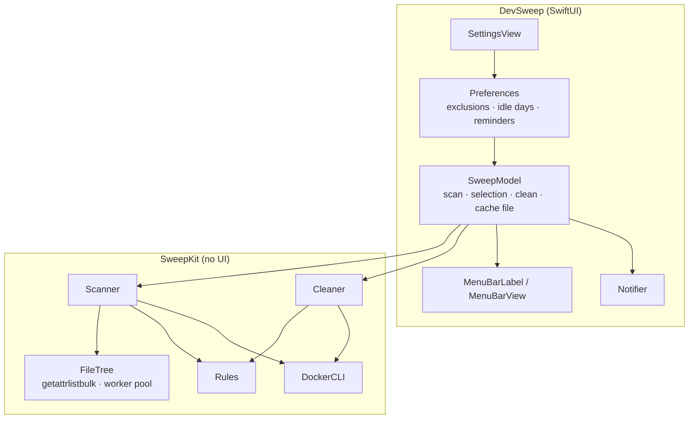

# Architecture

DevSweep is a menu bar app with no Dock icon. It scans the home folder for regenerable developer artifacts — project build and dependency folders, global package manager caches and Docker leftovers — and deletes the ones you select.

## Targets

| Target | Responsibility |
| --- | --- |
| `SweepKit` | Rules, the parallel file walker, scanning, size calculation, last-activity detection, cleaning with re-validation, the Docker CLI wrapper and the self-check. Imports only Foundation and Darwin. |
| `DevSweep` | SwiftUI menu bar extra, settings window, notifications, login item, scan cache, `--once` and `--render-screenshots` modes. |
| `SweepKitTests` | Runs `SelfCheck.run()` through XCTest. |

## Rules

`Rules.projects` lists project rules: folder names plus the marker files that must sit next to them (`node_modules` + `package.json`, `bin`/`obj` + `*.csproj`, …). A marker starting with `*` matches a suffix. When several rules share a folder name (`target` for Cargo and Maven, `build` for Gradle and Flutter) the first one whose marker is present wins.

`Rules.caches` lists global caches as paths relative to the home folder. They are only offered at exactly that path.

## Scanning

`Scanner.scan()` runs three things:

1. **Caches** — each cache folder that exists and is a real folder (not a symlink) is measured.
2. **Projects** — a parallel walk of the home folder.
3. **Docker** — `docker system df --format '{{json .}}'`, concurrently with the walk.

### The walk

`FileTree.traverse` runs a worker pool (one worker per core) over a shared stack of directories. Each directory is read with `getattrlistbulk`, which returns name, type, modification time, mount status, link count and allocated size for many entries in one system call — far fewer syscalls than `readdir` + `lstat`, which matters on machines where endpoint security software adds a cost to every file system call.

For every subdirectory of a visited directory:

| Check | Result |
| --- | --- |
| Excluded in Settings | skip |
| `Library`, `Applications`, `Pictures`, `Music`, `Movies`, `Public` directly under home | skip |
| `~/go/pkg` (read-only module cache) | skip |
| Package extension (`.app`, `.framework`, `.photoslibrary`, …) | skip |
| Mount point or symbolic link | skip (never listed as a directory) |
| Name and a sibling marker match a project rule | **artifact**, don't descend |
| Hidden folder, or `node_modules`, `Pods`, `vendor`, `venv`, `DerivedData` without a marker | skip |
| Otherwise | descend |

Because markers are checked against the listing the walker already has, matching costs nothing extra.

### Sizes

`FileTree.allocatedSizes` walks every artifact in the same worker pool and sums the allocated size of regular files. Files with more than one hard link are not counted: deleting one link doesn't free the blocks (pnpm's store is the common case).

### Last activity

For each project, the newest modification time of a regular file up to six levels deep (at most 20 000 entries), skipping artifacts, hidden folders and `.DS_Store`. If a `.git` folder is found in the project or one of its parents, the modification times of `.git/index` and `.git/logs/HEAD` are considered too. Folder modification times are ignored because Finder updates them just by browsing.

Projects whose last activity is at least *N* days ago (Settings, default 30) are preselected after each scan.

## Cleaning

`Cleaner.clean()` processes the selected items one by one. For files it re-validates each artifact right before `removeItem`:

- the path is canonical (equals its standardized form, so no `..`),
- it is inside the home folder and not the home folder itself,
- it is a real directory according to `lstat` (not a symlink, not gone),
- it isn't excluded,
- a cache is still at exactly its rule's path; a project folder still has the rule's name and its marker file next to it.

Any failure is recorded with a reason and the item stays in the list. Docker items run `docker image prune --all --force`, `docker container prune --force` or `docker builder prune --all --force`; volumes are never pruned.

Freed space is the sum of the scanned sizes of what was removed. It is added to *Freed so far*.

## App behavior

| When | What happens |
| --- | --- |
| Launch | The last scan is loaded from `~/Library/Application Support/io.github.recepysl.dev-sweep/last-scan.json`. If it is older than 24 h (or missing) a new scan starts. |
| Every hour | Free disk space is refreshed; a scan starts when the last one is older than 24 h. |
| Rescan / exclusions changed in Settings | A new scan starts; a running scan is cancelled first. |
| Exclude from Scans (context menu) | The path is added to the exclusions and the item disappears without a rescan. |
| Clean | One confirmation listing the items; cleaning runs in the background with progress in the footer. |

### Menu bar color

| Color | When |
| --- | --- |
| Red | less than 5 % of the disk is free |
| Orange | less than 10 % free, or reclaimable space is above the reminder threshold (default 10 GB) |
| Default | otherwise |

### Notifications

Only after automatic scans, never after a manual one:

- **Disk almost full** (< 10 % free) — at most once a day.
- **A lot to clean** (above the threshold) — at most once a week. The first time the threshold is crossed only starts the clock, so a fresh install doesn't greet you with a notification.

## Testing

`SelfCheck.run()` builds a fake home folder in a temporary directory with projects, orphan `node_modules`, hidden tool folders, an app bundle, `~/Library` content, symlinks and hard links, then checks:

- rule matching and marker patterns,
- what the scanner finds and what it must ignore,
- hard links not counted, symlinks not followed, exclusions honored,
- last activity and idle preselection,
- every cleaner refusal (outside home, `..`, symlink, wrong rule, wrong cache path, marker gone),
- that cleaning removes exactly the artifact and leaves sources, markers, symlinks and other hard links alone,
- Docker `system df` parsing and size units.

It runs with `--selftest`, `swift test`, and in CI on every push. `--once` exercises the real scanner against your own home folder without deleting anything.
